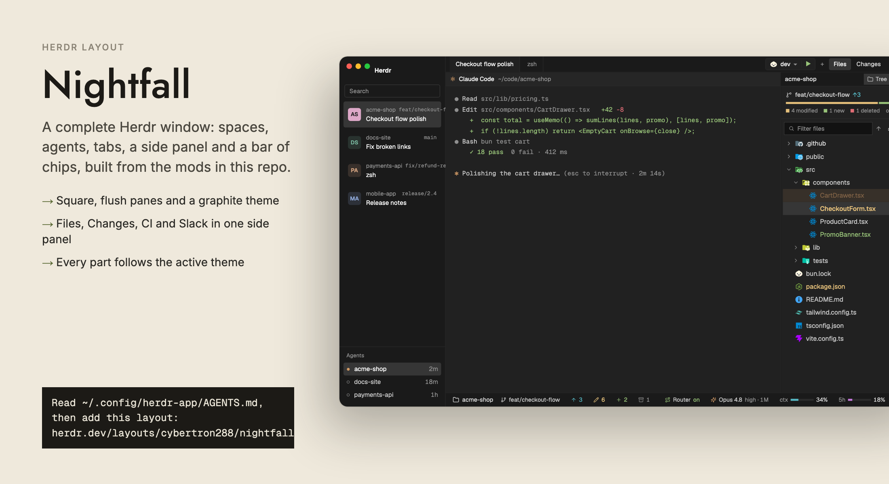

# herdr-nightfall

**Nightfall**, a graphite whole-window layout for the [Herdr app](https://herdr.dev):
spaces and agents in the sidebar, a tab bar with a run control and panel buttons, a side
panel with Files, Changes, CI and Slack, now playing from YouTube Music, and a bar of git
and Claude Code chips.

[](nightfall)

The [`nightfall/`](nightfall) folder is the layout as
[herdr.dev/layouts](https://herdr.dev/layouts) lists it: `layouts/nightfall.json`, its
theme, every mod it places, a `RECIPE.md` an agent can rebuild it from, and `preview.png`.

## Install

Tell your agent:

```text
Read ~/.config/herdr-app/AGENTS.md, then add this layout: herdr.dev/layouts/cybertron288/nightfall
```

Or by hand; see [nightfall/README.md](nightfall/README.md).

The mods it shares with other layouts (filetree, file-icons, session-bar, run-scripts,
ci-dash, slack, yt-music) come from [herdr-mods](https://github.com/cybertron288/herdr-mods),
where each can be added on its own.

## Licence

MIT, see [LICENSE](LICENSE), for the parts written here. Parts based on other work keep
their own terms; see [THIRD_PARTY_NOTICES.md](THIRD_PARTY_NOTICES.md).
