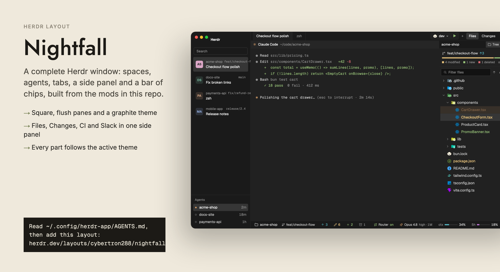

# Nightfall layout

A graphite layout for the Herdr app: square, flush panes with 28 px headers, a sidebar of
spaces and agents on the left, a tab bar with panel buttons on top, a side panel on the
right and a bar of chips at the bottom.



## Install

Tell your agent:

```text
Read ~/.config/herdr-app/AGENTS.md, then add this layout: herdr.dev/layouts/cybertron288/nightfall
```

Or by hand, from a clone of this repo:

```sh
H=~/.config/herdr-app
cp nightfall/layouts/nightfall.json nightfall/layouts/nightfall.svg "$H/layouts/"
cp nightfall/themes/nightfall.json "$H/themes/"
cp -R nightfall/mods/* "$H/mods/"
herdr-app do layout.switch --name nightfall
```

The bottom bar's Claude chips need session-bar's Claude Code plugin:

```sh
claude plugin marketplace add cybertron288/herdr-mods
claude plugin install session-bar@herdr-mods
```

`ctrl-shift-l` switches back to your previous layout. Deleting the files removes it.

## What you see

| Region | Block id | Mod |
|---|---|---|
| Sidebar top: logo, fold, search, new space | `brand` | `nightfall-chrome` |
| Spaces list | `spaces` | `nightfall-spaces` |
| Agents list | `agents` | `nightfall-agents` |
| Sidebar footer: settings, machines | `sidebar-footer` | `nightfall-chrome` (`footer` prop) |
| Tab bar, run control, `+`, panel buttons | `tabs` | `nightfall-tabs` (with `run-scripts`) |
| Pane headers | in `main` | `nightfall-pane` |
| Side panel: Files, Changes, CI, Slack | `panel-body` stack | `filetree`, `nightfall-changes`, `ci-dash`, `slack` |
| Under the side panel: now playing | `yt-music` | `yt-music` |
| Bottom bar | `status` | `session-bar` |
| Slack connection (0 px) | `slack-bg` | `slack` |

The theme is `nightfall` (graphite: canvas `#121212`, chrome `#1a1a1a`, cards `#212121`)
and the terminal font is **Geist Mono Nightfall**, which ships in
`mods/nightfall-chrome/fonts/` and loads by itself.

The shared mods (filetree, file-icons, session-bar, run-scripts, ci-dash, slack, yt-music)
are copies from [herdr-mods](https://github.com/cybertron288/herdr-mods), where each has its
own README and recipe.

## The Nightfall mods

| Mod | What it does |
|---|---|
| `nightfall-chrome` | The sidebar's top (logo, fold button, search, `+` new space) and, with `footer`, its bottom (settings, machines). Carries the font and the shared icons. |
| `nightfall-spaces` | Spaces as two-line cards: a colored avatar with the state dot, the name, branch or time in state, the tab's title, `↑↓`, and worktrees under their repo. The shown space has the selected fill and a solid avatar. Drag to reorder, right-click for the menu. |
| `nightfall-agents` | Agents grouped by state, sub-agents under their parent, Idle in a drawer. |
| `nightfall-tabs` | Tab bar: tabs, the `run-scripts` control, `+`, and buttons for the side panel (Files, Changes, CI, Slack). The panel's choice is remembered per tab. |
| `nightfall-pane` | Pane header: program icon, name or title, folder, state dot; split, zoom and close on hover. |
| `nightfall-changes` | The Changes panel: changed files, diffs, and a commit box. |

They use only theme colors, so the theme picker restyles them too.

## Leaving parts out

Each side panel button only matters if its block is in `panel-body`. To drop CI or Slack,
remove its block from `layouts/nightfall.json` and its `panelButton` line in
`mods/nightfall-tabs/main.js`. The `yt-music` block takes no room while nothing plays.
