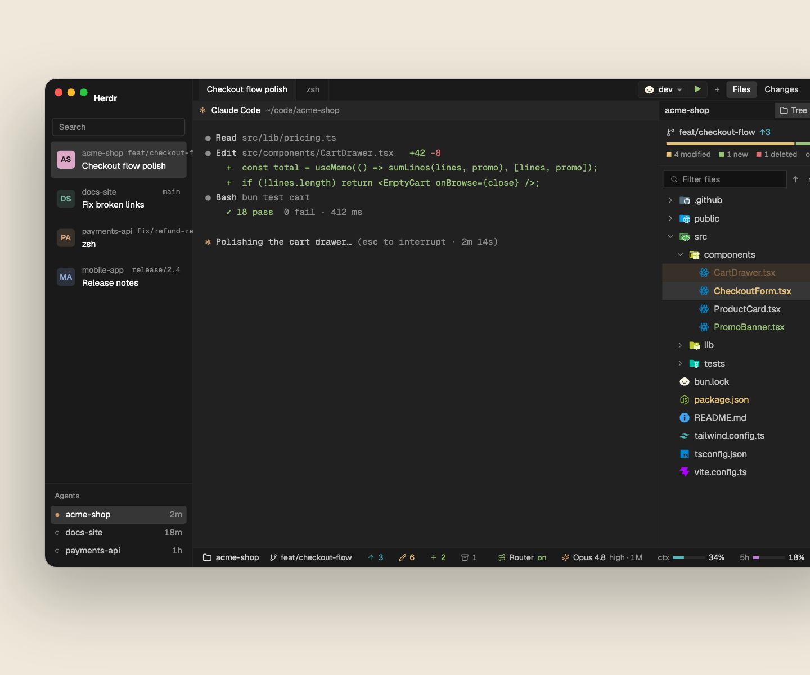

# Nightfall

A graphite, whole-window layout for the Herdr app. On the left is a 300px sidebar with the Herdr logo, search, a list of spaces drawn as two-line cards, and an agents list grouped by state. On the right is a 38px tab bar with a run control, a `+` button and Files, Changes, CI and Slack buttons. Below it are square, flush panes with 28px headers, an optional side panel, and a 28px bottom bar. Everything is dark grey with 4px corners. State colors (amber, red, green) are the only color besides each space's own pastel avatar.



## What you see

The window has no OS title bar (`titlebar: none`). On macOS the traffic lights sit at `[12, 16]`. The layout background is `canvas`. Dividers between blocks are 1px in `border`. The terminal font is **Geist Mono Nightfall**, a Geist Mono build that ships with the layout. Terminal padding is `[14, 12]`.

### Theme `nightfall`

Terminal colors: background `#212121`, foreground `#c4c4c4`, selection `#3a3a3a`, cursor `#d6d6d6`. ANSI 0-7 are `#212121 #e06c75 #98c379 #d19a66 #61afef #c678dd #56b6c2 #abb2bf`. ANSI 8-15 are `#5c6370 #e06c75 #98c379 #e5c07b #61afef #c678dd #56b6c2 #ffffff`.

Named colors:

| Name | Hex |
|---|---|
| canvas | `#121212` |
| chrome | `#1a1a1a` |
| surface | `#212121` |
| popover | `#1d1d1d` |
| raised | `#2b2b2b` |
| hover | `#262626` |
| selected | `#363636` |
| border | `#2a2a2a` |
| input | `#383838` |
| muted | `#d6d6d6` |
| dim | `#8f8f8f` |
| accent, solid | `#e0e0e0` |
| accent_foreground, solid_foreground | `#121212` |
| working | `#e5c07b` |
| blocked | `#e06c75` |
| done | `#98c379` |
| idle | `#8f8f8f` |

The sidebar is on `chrome`. Tab bar, pane headers and panels use `chrome`, with `raised` for the focused pane header.

### Sidebar (300px wide, left, `chrome`)

From top to bottom:

1. **Brand (66px).** Two rows. Row 1 is 38px: a 16px Herdr logo, the word "Herdr" (13.5px, semibold, white), and a fold button at the right. On macOS this row starts 76px in, to clear the traffic lights. Row 2 is 28px: a search field (24px tall, canvas fill, 1px `input` border, "Search" in dim text), a filter button and a `+` new-space button, both 24px. The block drags the window.
2. **Spaces** (weight 3, min 90px). One card per space, 61px tall (57px card plus padding). Left is a 28px avatar tile with 6px corners. It shows the space's two letters in one of 12 powdery colors, with a state dot at its bottom-right corner. Line 1 is the space name (12px) and, at the right, either the time in state ("waiting 4m", "working 2m", "done 3m ago", in mono 11px) or the git branch with a branch icon (mono 11px). Line 2 is the shown tab's title (13px, medium), then `↑n` `↓n` ahead/behind counts, then, for a repo with worktrees, a fork button with the worktree count. Open worktrees show as 28px lines under the card.
3. **Agents** (weight 2, min 90px, top border). A 41px header "Agents" with a sort icon at the right. Below are agent rows 30px tall: program icon, space name, `· detail` in dim, a pin button on hover or the time since the last state change (`<1m`, `12m`, `3h`, `2d`), and a state mark in a 16px slot. Sub-agents are 26px rows indented under their parent with tree lines.
4. **Footer (36px, top border).** A settings button (30px, with a small accent dot when an update is ready), a machines button, and at the right the name of the shown space's machine ("This computer" by default).

Below 160px wide, the sidebar becomes a rail: a logo/open button, search, 36px avatar tiles, a `+`, and at the bottom settings and machines.

### Work area (right of the sidebar)

- **Tab bar (38px, `chrome`).** Docked tabs, 140-260px wide, with program icon, title and a 20px close button. The active tab uses the terminal background with no bottom line. Others sit on `chrome` with a bottom border. At the right, in order: the run-scripts control (only when the focused folder has a `package.json` with scripts), a 28px `+` button, then four 28px-tall buttons: **Files**, **Changes** (with `+n` `−n` line counts when the shown space has changes), **CI**, **Slack** (with a red unread badge). The open panel's button has a `selected` fill. On Windows and Linux, minimize, maximize and close buttons follow.
- **Panes** (`main`). The shown tab's panes with a 6px gap, no border (width 0, radius 0), `lone: true`. Each pane has a 28px header on top, always visible. It holds the program icon (14px), the agent's name or the terminal title (12px, medium), the folder (`~/...`, dim, truncated), and a 9px state mark.
- **Side panel (368px, min 280, max 900, starts hidden).** A stack with four panels: Files, Changes, CI runs, Slack. Under the stack is the YT Music strip, a 0px block that grows only when a track plays.
- **Bottom bar (`status`, 28px).** The `session-bar` chips: folder and git state on the left, Claude usage on the right.
- **`slack-bg` (0px).** An invisible block that keeps the Slack connection alive when the Slack panel is closed.

## How it behaves

### Agent states

| State | Color | Mark | Card time text |
|---|---|---|---|
| working | `#e5c07b` | turning arc (900ms) | "working 5m", dim |
| blocked | `#e06c75` | filled dot | "waiting 5m", red |
| done | `#98c379` | filled dot | "done 5m ago", green |
| idle | `#8f8f8f` | hollow ring | none |

- A space card shows its most urgent state (blocked, then done, then working, then idle) as the dot on its avatar. Idle with no agent shows no dot. A space waiting 5 minutes reads "waiting 5m" in red on line 1. On the rail the dot is the most urgent state of the space and its worktrees.
- The agents list sorts by **Priority** (default, flat list, most urgent first) or **Grouped by space**. The sort icon opens a menu. In Priority, a parent takes the place of its most urgent sub-agent. Grouped has folding headers. Idle agents go in a closed drawer at the foot, which still shows the focused idle agent. Opening a done agent keeps it in Done until you leave it.
- A tab shows its state mark next to its title unless it is idle. A pane header shows the dot unless idle.

### Spaces

- The shown space has the `selected` fill, white text and a solid avatar tile in the space's color. Hovering a card inverts the avatar the same way.
- Click selects. Drag a card to another card to move it (a 2px accent line marks the drop). Right-click opens the Herdr space menu.
- Hover shows a pin. A pinned space moves to the top and keeps a pin on its avatar. Hovering a pinned card turns the pin into pin-off.
- Clicking `↑n ↓n` opens the Changes panel for that space (it selects the space first if needed).
- The fork button toggles that repo's worktrees under the card. It turns red while a hidden worktree is blocked.
- With other machines, each machine gets a header (fold, `+`, connection dot).

### Agents

- Click focuses the agent's pane. Right-click offers Rename (renames its tab). Pin button on hover. Sub-agent rows open a peek of that terminal. A chevron folds sub-agents and shows their count in the most urgent color.

### Tab bar and side panel

- Click a tab to select it. Drag to reorder. Double-click to rename. Right-click for the Herdr tab menu. The wheel switches tabs. `+` opens the Herdr new-tab menu.
- A panel button shows that panel and the side panel. Clicking the open panel's button hides the panel.
- The panel choice is remembered per tab. A tab with no choice opens Files. Closing the panel sticks for that tab. Choices of closed tabs are dropped.
- Click Slack: the badge counts unread direct messages and mentions.
- The run-scripts control shows `▾ script ▶` (see run-scripts at herdr.dev/mods/cybertron288/run-scripts).

### Pane headers

- Click focuses the pane. The focused header is `raised` with a white name. Hover shows four 22px buttons: split right, split down, zoom or unzoom, close.

### Changes panel

- 28px header "Changes", a `N files` tag and `+n −n` totals. The list is at most 200px tall, with status letters A, M, D, U. Click a file to open its diff below (added lines green, removed lines red, line numbers on the left). With no file open it says "Select a file to view its changes".
- The commit box is at the bottom: a text field and a **Commit** button. The button is enabled only with a non-empty message in a git folder. It runs `git add -A` and then `git commit -m <message>`, then clears the box and refreshes. A failure shows "Commit failed: ..." in red.

### Getting back

`ctrl-shift-l` switches back to the previous layout. Deleting the files removes Nightfall.

## Built from

### Files

```
layouts/nightfall.json   layouts/nightfall.svg   layouts/README.md
themes/nightfall.json
mods/nightfall-chrome/   (icons + fonts/)
mods/nightfall-spaces/   mods/nightfall-agents/   mods/nightfall-tabs/
mods/nightfall-pane/     mods/nightfall-changes/
mods/filetree/ mods/file-icons/ mods/session-bar/ mods/run-scripts/
mods/ci-dash/ mods/slack/ mods/yt-music/
```

Each `nightfall-*` mod has `mod.json` with `{ "place": "none" }` (plus a `title` on agents, pane, spaces and tabs). They are used only as layout blocks. `nightfall-chrome` holds the icons the other Nightfall mods draw from `mods/nightfall-chrome/*.svg`.

### Layout root

`layouts/nightfall.json`: root `row`, `background: "canvas"`, `theme: "nightfall"`, `font: "Geist Mono Nightfall"`, `terminal_padding: [14, 12]`, `divider: { width: 1, color: "border" }`, `titlebar: "none"`, `traffic_lights: [12, 16]`, `preview: "layouts/nightfall.svg"`.

```
root (row)
├─ sidebar (column) size px 300, min 52, max 480, background chrome, resizable false
│   ├─ brand           block  nightfall-chrome                    px 66, window_drag
│   ├─ sidebar-lists   column
│   │   ├─ spaces      block  nightfall-spaces                    weight 3, min 90
│   │   └─ agents      block  nightfall-agents                    weight 2, min 90
│   └─ sidebar-footer  block  nightfall-chrome  props {footer:true}  px 36
└─ work (column) resizable false
    ├─ tabs            block  nightfall-tabs                      px 38, window_drag
    ├─ work-body (row) padding 0, gap 6
    │   ├─ main        block  { tab: "active", pane: {...} }
    │   └─ panel (column) px 368, min 280, max 900, hidden true
    │       ├─ panel-body (stack, active "files")
    │       │   ├─ files    block filetree
    │       │   ├─ changes  block nightfall-changes
    │       │   ├─ ci       block ci-dash  props {panel:true}
    │       │   └─ slack    block slack    props {panel:true}
    │       └─ yt-music     block yt-music                        px 0, min 0
    ├─ status          block  session-bar                         px 28
    └─ slack-bg        block  slack  props {bg:true}              px 0, min 0
```

The `main` block's pane settings:

```json
"pane": {
  "header": { "content": { "mod": "nightfall-pane" }, "reveal": "always", "height": 28, "position": "top" },
  "background": "background",
  "border": { "width": 0, "color": "border" },
  "radius": 0,
  "gap": 6,
  "lone": true
}
```

### Block to mod

| Block id | Mod | Props |
|---|---|---|
| `brand` | `nightfall-chrome` | none |
| `sidebar-footer` | `nightfall-chrome` | `footer: true` |
| `spaces` | `nightfall-spaces` | none |
| `agents` | `nightfall-agents` | none |
| `tabs` | `nightfall-tabs` | none |
| pane header in `main` | `nightfall-pane` | the app passes `{ pane, terminal }` |
| `files` | `filetree` | none |
| `changes` | `nightfall-changes` | none |
| `ci` | `ci-dash` | `panel: true` |
| `slack` | `slack` | `panel: true` |
| `yt-music` | `yt-music` | none |
| `status` | `session-bar` | none |
| `slack-bg` | `slack` | `bg: true` |

Shared mods come from `herdr.dev/mods/cybertron288/<name>` and are used unchanged: `filetree`, `file-icons` (the icon set `filetree` draws from), `session-bar`, `run-scripts`, `ci-dash`, `slack`, `yt-music`. Build each from its own RECIPE. Nightfall only places them.

### Shared state keys

| Key | Written by | Read by | Holds |
|---|---|---|---|
| `nightfall.spaces.pinned` | nightfall-spaces | nightfall-spaces | array of pinned space ids |
| `nightfall.panel.open` | nightfall-spaces | nightfall-tabs | `{ space, panel, at }`. Tabs applies it once, if less than 2s old and the panel is enabled |
| `nightfall.changes.lines` | nightfall-spaces | nightfall-tabs | `{ [space id]: { add, del } }` from `git diff HEAD --numstat` |
| `space.colors` | nightfall-spaces | nightfall-spaces (and Herdr's own spaces mod and picker) | `#rrggbb` per space id |
| `sidebar.width`, `sidebar.collapsed` | nightfall-chrome | nightfall-chrome | the width to restore when unfolding |
| `agents.sort` | nightfall-agents | nightfall-agents | `priority` or `grouped` |
| `workspace.panels` | not written by this layout | nightfall-tabs | optional list of enabled panels. Default `["files","changes"]`. `ci` and `slack` are always added |
| `filetree.view` | session-bar (its changed chip) | filetree | opens the Changed tab |
| `run-scripts` | run-scripts, nightfall-tabs (via `run-scripts.js`) | both | selected and recent script per project root |
| `slack.unread` | slack | nightfall-tabs | unread count for the Slack button badge |

Local storage (per mod, in the mod's own store): nightfall-tabs `panels` (the per-tab choice), nightfall-spaces `machines.folded` and `worktrees.open`, nightfall-agents `changed`, `pins`, `idle.open`.

### Herdr functions and commands

Commands (`run`):

- nightfall-chrome: `layout.resize` (sidebar, `px` 300 or last width, or 76 on macOS / 52 elsewhere for the rail), `space.new`, `app.settings`, `mod.open` (`picker`, `machine-add`).
- nightfall-spaces: `space.select`, `space.move`, `space.new` (with `machine` on remote headers), `layout.select`, `layout.show`.
- nightfall-agents: `pane.focus`, `tab.rename`, `terminal.peek`, `app.settings`, `mod.open`.
- nightfall-tabs: `tab.select`, `tab.move`, `tab.close`, `tab.rename`, `tab.prev`, `tab.next`, `layout.select` (stack `panel-body`), `layout.show` and `layout.hide` (id `panel`), `window.minimize`, `window.maximize`, `window.close`.
- nightfall-pane: `pane.focus`, `pane.split` (`direction` right or down), `pane.zoom`, `pane.close`.

Overlays (`openOverlay`): the Herdr `menu` mod for the space menu (`tab: "space"`) and the tab menu (`tab: "tab"`), `new-menu` for `+`, and nightfall-agents' own popups (sort menu 200x140, agent menu 180x52).

Other imports from `herdr`: `theme`, `settings`, `window`, `layout`, `keys` (to show the picker key in the search tooltip), `updates`, `spaces`, `machines`, `panes`, `agents`, `terminals`, `focused`, `home`, `setAgentOrder`, `watchFolder`, `shared`, `setShared`.

### Programs and files

- nightfall-spaces: `git` in each space's folder (`rev-parse --show-toplevel`, `rev-parse --path-format=absolute --git-common-dir`, `status --porcelain=v2 --branch`, `diff [HEAD] --numstat -z --no-renames`), all with `--no-optional-locks -c core.fsmonitor=false`. It also runs `hc ["machine","ls","--json"]` every 15s, and watches the repo folder. A folder watch triggers a refresh, plus a 60s fallback check while the window is in front.
- nightfall-changes: `git rev-parse --show-toplevel`, `git diff HEAD --no-ext-diff --no-textconv --no-color -- <path>`, `git add -A`, `git commit -m <message>`. It reads untracked or new files with `readTextFile` for the preview (up to 400,000 characters, 1,500 lines).
- nightfall-tabs: `readTextFile` of `package.json` up to 8 folders above the focused terminal, and `sh -c` to find a lock file (`bun.lock`, `bun.lockb`, `pnpm-lock.yaml`, `yarn.lock`). This code is the copy `run-scripts.js`.
- nightfall-chrome and nightfall-pane: no programs.

### Art

- Icons: SVG files in `mods/nightfall-chrome/` (Lucide-style, one-color), used by every `nightfall-*` mod. `nightfall-pane` has its own four (`split-right`, `split-down`, `zoom`, `unzoom`, `close`). `nightfall-changes` has `changes.svg`. CI and Slack buttons use `mods/ci-dash/ci.svg` and `mods/slack/message-square.svg`. The logo is Herdr's `frame/welcome/herdr.png`.
- Font: `mods/nightfall-chrome/fonts/GeistMonoNightfall-Regular.ttf`, `-Bold.ttf`, `-Italic.ttf`, `-BoldItalic.ttf`. Herdr loads them at start, so the layout can name `Geist Mono Nightfall`. The licence is SIL Open Font License 1.1, in `mods/nightfall-chrome/fonts/OFL.txt`. Ship it beside the fonts.
- Space avatar colors, in the order spaces take them: `#dda8c8 #78b79e #d6a582 #a5ae77 #aa9fd3 #8fc7c6 #b39fbf #bab37c #95c9a4 #caa1cc #78c1b6 #e4ac92`. Each new space takes the free color farthest in hue (OKLCH) from those in use. Avatar letters are the first two words' initials, or a one-word name's first letter and the first consonant after it.
- Preview: `layouts/nightfall.svg`.

## Watch out

- **Mods cannot import across folders.** `nightfall-tabs` needs the run-scripts code, so `mods/nightfall-tabs/run-scripts.js` is an identical copy of `mods/run-scripts/scripts.js`. Keep the two the same. Its import is `import { findProject, control as runControl } from "./run-scripts.js";`.
- **Panel buttons only matter if their block is in the stack.** `nightfall-tabs` draws CI and Slack buttons unconditionally. Files and Changes only draw if `enabled` lists them. If you drop the `ci` or `slack` block, also remove that `panelButton(...)` line in `nightfall-tabs/main.js`, or the button selects a child that is not there.
- **The panel and the stack ids are fixed.** The tabs mod calls `layout.select { stack: "panel-body", child: "<id>" }` and `layout.show/hide { id: "panel" }`. Keep the ids `panel`, `panel-body`, `files`, `changes`, `ci`, `slack`. The sidebar must keep the id `sidebar` and the layout resize call needs it.
- **Two 0px blocks must stay in the layout.** `yt-music` has `size.px: 0` and `min: 0` so it takes no room until a track plays. `slack-bg` is a 0px `slack` block with `bg: true` that keeps Slack connected when the panel is closed. Without it unread counts and notifications stop while the Slack panel is closed. Give both `min: 0`, or they keep a minimum height.
- **Square corners come from `panel` props.** Panes are square because the `pane` object sets `radius: 0`, `border.width: 0` and `gap: 6`. The 4px corners on buttons, rows and cards are in the Nightfall mods' code (`R = 4`), not the layout. All mods read theme colors only, so another theme restyles them.
- **The side panel starts hidden, but tabs open it.** `panel` has `hidden: true`. On first render `nightfall-tabs` opens Files for any tab with no stored choice, so the panel appears at once.
- **`sidebar` has `resizable: false` and `size.px: 300`.** Dragging is off. The fold button resizes it to 76px on macOS or 52px on other systems. Below 160px the mods draw a rail by reading the width, not a flag.
- **Idle agents without a pane are not listed.** Sub-agents without a pane use their raw status (`error` counts as blocked, `done` counts as idle).
- **Changes shows at most 1,000 files** and previews at most 1,500 diff lines per file, with lines over 4,000 characters cut.
- **Commit stages everything.** The Commit button runs `git add -A` first, so untracked files go in too. There is no confirm step.
- **Run control needs a JavaScript project.** It only appears if a `package.json` with scripts is within 8 folders above the focused terminal. It reads those files and, with a lock file found, picks that package manager.
- **Windows buttons.** The minimize, maximize and close buttons draw only if `window().buttons` is true.
- **Which mods run programs, reach the network or read outside their folder** (tell the person before installing):
  - `nightfall-spaces`: runs `git` and `hc`, reads repo folders, watches folders. No network.
  - `nightfall-changes`: runs `git` (including `add -A` and `commit`), reads files in the focused repo.
  - `nightfall-tabs`: runs `sh`, reads `package.json` files, and the run control can start scripts with the project's package manager in a new tab.
  - `nightfall-chrome`, `nightfall-agents`, `nightfall-pane`: no programs, no network, no file reads outside their folder. They run Herdr commands.
  - Shared mods: `filetree` runs `git`, `du`, `mkdir`, `open`, `sh` and reads files. `file-icons` runs `git`, `sh` and reads files. `session-bar` runs `git` and `mkdir` and reads files. `run-scripts` runs `sh` and package scripts. `ci-dash` runs `gh` (GitHub CLI, needs `gh auth login`) and `git`, so it reaches GitHub. `slack` uses `curl` and `fetch` to reach slack.com and api.slack.com, and stores a token on disk. `yt-music` is macOS only, runs `osascript` through `hc` and talks to Google Chrome. Each one's own RECIPE says what it does.
- **The theme and font are named in the layout.** If `themes/nightfall.json` is missing the layout falls back to the app's theme and the mods use their colors from it. If the font files are missing, the terminal uses the default font.

## Done when

1. Each mod passes `herdr-app check` (run from the Herdr config folder, one at a time): `nightfall-chrome`, `nightfall-spaces`, `nightfall-agents`, `nightfall-tabs`, `nightfall-pane`, `nightfall-changes`, `filetree`, `file-icons`, `session-bar`, `run-scripts`, `ci-dash`, `slack`, `yt-music`.
2. `herdr-app do layout.switch --name nightfall` switches the window with no error.
3. The sidebar is 300px wide on `#1a1a1a`: logo and "Herdr" on top, spaces as 61px cards with avatars and state dots, an "Agents" header, and a 36px footer with settings and machines.
4. The tab bar is 38px with `+` and Files, Changes, CI and Slack buttons. Clicking Files opens a 368px side panel with the file tree. Clicking it again hides the panel.
5. Switch to a second tab. Open Changes there, switch back and forth. Each tab restores its own panel choice. A new tab opens Files.
6. Each pane has a 28px header with icon, name, folder and, on hover, split right, split down, zoom and close buttons. Panes have no border and no rounded corners.
7. With an agent working, its space card shows an amber turning arc and "working Nm". When it needs input the dot is red and the card says "waiting Nm". When it finishes the dot is green and the card says "done Nm ago".
8. In a git folder with a changed file, the Changes panel lists it, a click shows its diff, and writing a message and pressing Commit makes a commit and empties the list. The tab bar's Changes button shows `+n −n` for the shown space.
9. Pin a space: it moves to the top. Drag a space onto another: it moves. Right-click a space: the menu opens.
10. Drag the sidebar's fold button: it narrows to a rail with avatars. Press it again: the sidebar returns to 300px.
11. The bottom bar is 28px with the folder and git chips. The terminal text is in Geist Mono Nightfall.
12. `ctrl-shift-l` returns to the previous layout.

## Files

- `layouts/nightfall.json`, `layouts/nightfall.svg`, `layouts/README.md`
- `themes/nightfall.json`
- `mods/nightfall-chrome/` (with `fonts/` and `fonts/OFL.txt`)
- `mods/nightfall-spaces/`, `mods/nightfall-agents/`, `mods/nightfall-tabs/` (with `run-scripts.js`), `mods/nightfall-pane/`, `mods/nightfall-changes/`
- `mods/filetree/`, `mods/file-icons/`, `mods/session-bar/`, `mods/run-scripts/`, `mods/ci-dash/`, `mods/slack/`, `mods/yt-music/` (from herdr.dev/mods/cybertron288/*)
- `RECIPE.md`, `preview.png`
